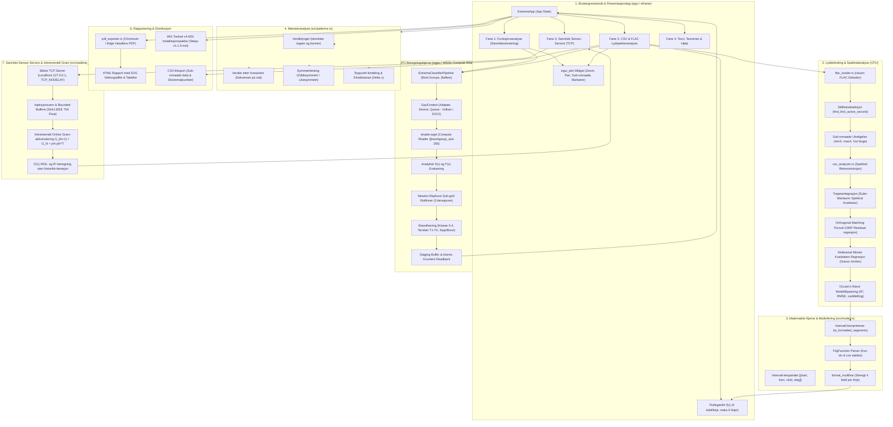
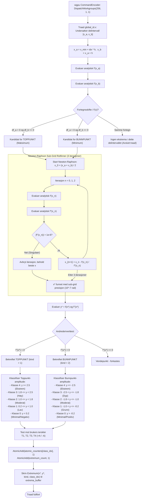
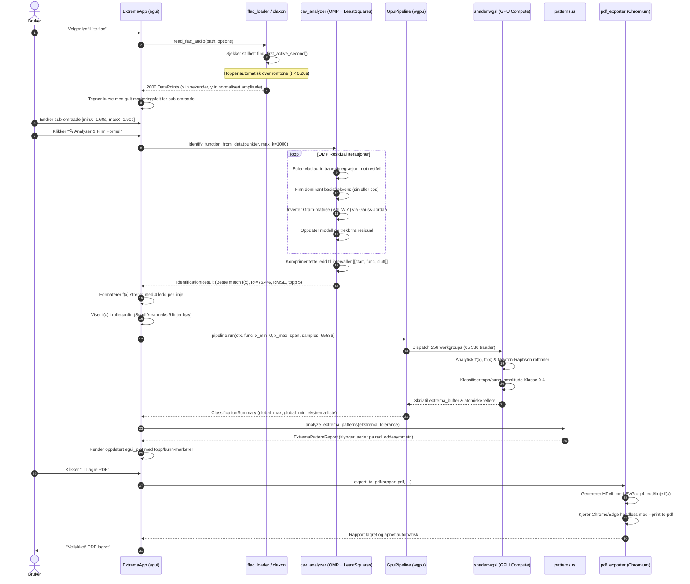
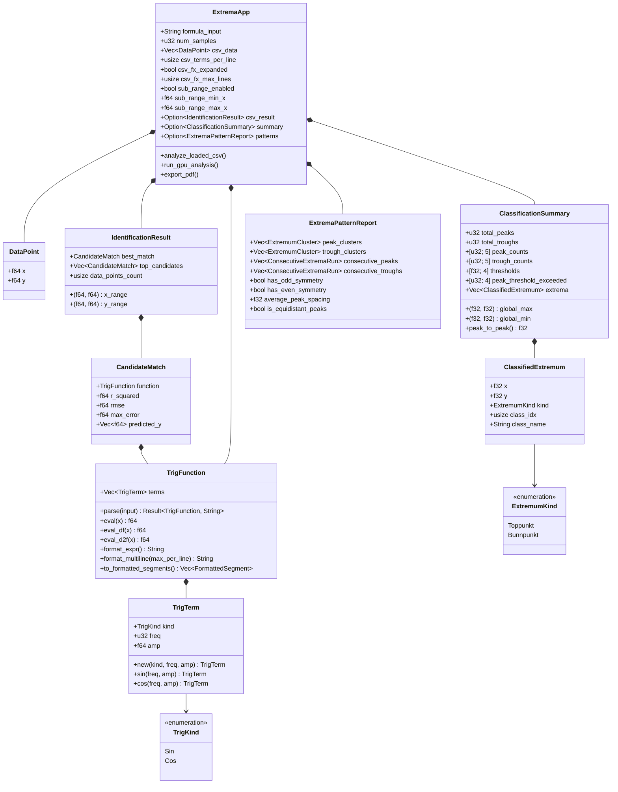
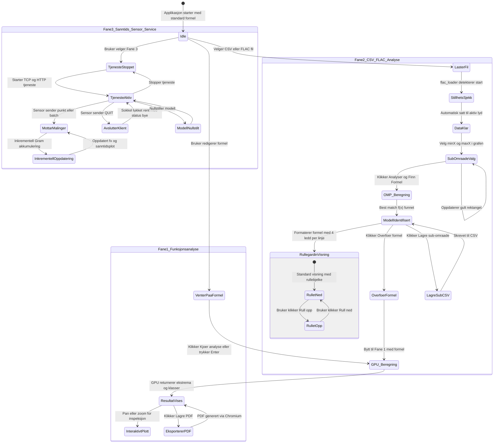
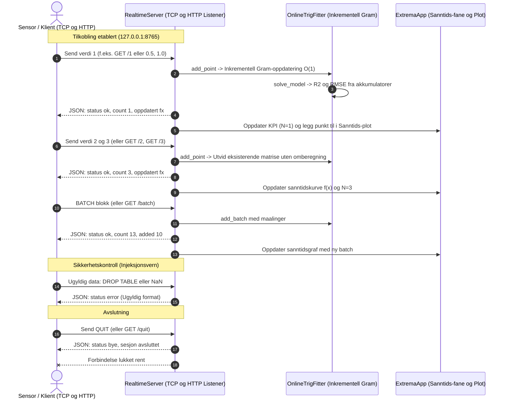

# Trigonometrisk Ekstremanalyse & Rekonstruksjon (GPU Sanntid)

Et høytytende beregningssystem utviklet i **Rust** som utnytter GPU (via `wgpu` med Vulkan/DirectX 12) til massivt parallell evaluering, derivasjon, ekstremalklassifisering og formelrekonstruksjon av trigonometriske funksjoner.

Systemet består av to integrerte moduler:
1. **Sanntids GPU-Klassifisering**: Analytisk ekstremalsøk, amplitude-kategorisering (Klasse 0–4), terskeltester og mønsteranalyse for summer av trigonometriske ledd.
2. **Spektral Formelrekonstruksjon**: Hybrid invers Fourier- og OMP-identifisering (Orthogonal Matching Pursuit) fra vilkårlige CSV-måledata med multivariat minste-kvadraters regresjon og trapesintegrasjon. Gjenvinner eksakte formler uten krysstale på både periodiske og ikke-periodiske intervaller, og komprimerer tette harmoniske rekker tilbake til intervallnotasjon.

> [!IMPORTANT]
> **Støttede funksjoner:** Programmet støtter vilkårlige lineærkombinasjoner av **KUN sinus (`sin`) og cosinus (`cos`)**. Andre matematiske funksjoner (som `tan`, `cot`, `sec`, `exp`, `log`, etc.) støttes ikke og avvises deterministisk i parsingsleddet.

> [!TIP]
> **Arkitektur & Systemdiagrammer:** Komplett teknisk arkitektur med interaktive Mermaid-diagrammer (systemarkitektur, GPU compute pipeline, sekvensdiagram, domenemodell og GUI-tilstandsmaskin) finnes nå direkte integrert i [Seksjon 3: Teknisk Arkitektur & Systemdiagrammer](#3-teknisk-arkitektur--systemdiagrammer).

## Bilder


---

## 1. Funksjonsdefinisjon og Intervallsyntaks

Programmet opererer på den generelle familien av trigonometriske polynomer over det fundamentale intervallet $x \in [0, 2\pi]$:

$$f(x) = \sum_{k=1}^{K} a_k \sin(\omega_k x) + \sum_{m=1}^{M} b_m \cos(\lambda_m x)$$

hvor $a_k, b_m \in \mathbb{R}$ er reelle amplituder og $\omega_k, \lambda_m \in \mathbb{N}^+$ er positive heltallsfrekvenser.

### Syntaksregler:
1. **Enkeltledd med multiplikatorer**:
   - `sin(x) + cos(2x) - 1.5*sin(4x)`
   - Støtter konstanter både før og etter leddet: `2*sin(x)`, `2sin(x)`, `sin(x)*2.5`.
   - Norsk og internasjonal desimalnotasjon støttes: `3,5*cos(2x)` eller `3.5*cos(2x)`.
2. **Kompakt intervallnotasjon med valgfri steglengde**:
   $$\left[\left[\text{start},\, \text{func},\, \text{slutt},\, \text{steg?}\right]\right]$$
   - `func` **MÅ være et sinus- eller cosinus-uttrykk** (med eller uten amplitude/konstant).
   - `steg` er valgfritt (standardverdi er $1$).
   - **Eksempler**:
     - `[[1, sin(x), 5]]` ekspanderer til:
       $$\sin(x) + \sin(2x) + \sin(3x) + \sin(4x) + \sin(5x)$$
     - `[[4, 3*cos(x), 100]]` ekspanderer til 97 ledd:
       $$3\cos(4x) + 3\cos(5x) + \dots + 3\cos(100x)$$
     - `[[1, sin(x), 9, 2]]` ekspanderer med steglengde 2 til odde harmoniske:
       $$\sin(x) + \sin(3x) + \sin(5x) + \sin(7x) + \sin(9x)$$
     - Flere intervaller kan kombineres fritt:
       `[[1, sin(x), 3]] + [[2, cos(x), 4]]`

---

## 2. Teoretisk Fundament og Hvorfor Teoremene er Viktige

Systemet bygger på tre fundamentale matematiske prinsipper. I stedet for abstrakte bevis, belyser denne seksjonen hvorfor hvert teorem er kritisk for beregningsnøyaktighet, GPU-ytelse og robust formelgjenvinning:

---

### Teorem 1: Analytiske Deriverte og Kvadratisk Konvergens (Newton-Raphson)

For den generelle trigonometriske funksjonen:
$$f(x) = \sum_{k} a_k \sin(\omega_k x) + \sum_{m} b_m \cos(\lambda_m x)$$

beregnes de eksakte deriverte analytisk i stedet for numerisk:
$$f'(x) = \sum_{k} \omega_k a_k \cos(\omega_k x) - \sum_{m} \lambda_m b_m \sin(\lambda_m x)$$
$$f''(x) = -\sum_{k} \omega_k^2 a_k \sin(\omega_k x) - \sum_{m} \lambda_m^2 b_m \cos(\lambda_m x)$$

Nullpunkter for førstederiverte ($f'(x^*) = 0$) klassifiseres direkte via andrederiverttesten:
* **Toppunkt (Maksimum)**: $f''(x^*) < 0$
* **Bunnpunkt (Minimum)**: $f''(x^*) > 0$

Sub-grid ekstremalpunkter lokaliseres med Newton-Raphson iterasjon på GPU:
$$x_{n+1} = x_n - \frac{f'(x_n)}{f''(x_n)}$$

#### Hvorfor dette teoremet er viktig:
1. **Eliminerer numerisk differensiasjonsstøy på GPU**: Numerisk derivasjon (som finite differences) taper maskinpresisjon, er svært følsom for avrundingsfeil ved små steglengder ($\Delta x$), og krever flere kostbare minneaksesser. Analytisk derivasjon gir eksakt matematisk presisjon uten tap av signifikante siffer.
2. **Kvadratisk konvergens ($\mathcal{O}(e_n^2)$) gir sanntidsytelse**: Ved standard diskret grid-søk ville sub-grid nøyaktighet på $10^{-7}$ krevd milliarder av evalueringspunkter, noe som ville overbelastet GPU-minnet og båndbredden. Med Newton-Raphsons kvadratiske feildobling dobles antallet korrekte desimaler for hver iterasjon. Hver GPU-tråd oppnår dermed full maskinpresisjon på kun 2–3 iterasjoner, uavhengig av frekvens.
3. **Analytisk sikkerhet mot feilklassifisering**: Den analytiske andrederiverte $f''(x^*)$ garanterer en ufeilbarlig distinksjon mellom lokale maksima, minima og vendepunkter, selv i kaotiske interferensmønstre der flere bølgetopper ligger ekstremt tett.

---

### Teorem 2: Fourier-Ortogonalitet i Hilbert-rommet $L^2([0, 2\pi])$

Mellom vilkårlige harmoniske svingninger over $[0, 2\pi]$ gjelder de fundamentale ortogonalitetsrelasjonene:
$$\langle \sin(kx), \sin(mx) \rangle = \pi \delta_{km}, \quad \langle \cos(kx), \cos(mx) \rangle = \pi \delta_{km}, \quad \langle \sin(kx), \cos(mx) \rangle = 0$$

hvor $\delta_{km}$ er Kronecker-deltaet ($\delta_{km} = 1$ hvis $k=m$, ellers $0$). 

Dette tillater isolert projeksjon av hver enkelt amplitude:
$$a_k = \frac{1}{\pi} \int_0^{2\pi} f(x) \sin(kx) \, dx, \quad b_k = \frac{1}{\pi} \int_0^{2\pi} f(x) \cos(kx) \, dx$$

#### Hvorfor dette teoremet er viktig:
1. **Null kryss-interferens mellom frekvenser**: Ortogonaliteten garanterer at beregningen av én harmonisk komponent (f.eks. $\sin(5x)$) er fullstendig uavhengig av om signalet også inneholder $\sin(4x)$, $\cos(100x)$ eller 90 andre ledd. Ingen komponent "lekker" energi over til andre frekvenser i det kontinuerlige domenet.
2. **Unngår ustabile matrise-inversjoner**: I stedet for å måtte løse store, dårlig kondisjonerte lineære ligningssystemer ($N \times N$) eller risikere overtilpasning (overfitting) med tradisjonell polynomisk regresjon, kan hver koeffisient bestemmes direkte og deterministisk via en uavhengig integralprojeksjon i $\mathcal{O}(N)$ tid.
3. **Optimal støyfiltrering**: Tilfeldig målestøy (hvit støy) er jevnt fordelt over alle frekvenser og har tilnærmet null projeksjon mot de ortogonale basisfunksjonene. Ortogonal integrasjon fungerer derfor som et optimalt støyfilter som trekker frem de sanne signalfrekvensene selv fra ufullstendige eller støyfylte målinger.

---

### Teorem 3: Trapesregelen og Spektral Nøyaktighet (Euler-Maclaurin)

Ved diskret Fourier-analyse av måledata med $N$ punkter på et lukket intervall $[0, 2\pi]$:
$$x_i = i \cdot \Delta x, \quad \Delta x = \frac{2\pi}{N - 1}, \quad i = 0, \dots, N-1$$
benytter systemet korrigerte trapesvekter:
$$w_0 = \frac{\Delta x}{2}, \quad w_{N-1} = \frac{\Delta x}{2}, \quad w_i = \Delta x \quad (0 < i < N-1)$$

i stedet for en naiv likevektet Riemann-sum.

#### Hvorfor dette teoremet er viktig:
1. **Eliminering av kunstig randlekkasje (Endepunktsdobling)**: I en lukket måleserie $[0, 2\pi]$ representerer $x=0$ og $x=2\pi$ nøyaktig samme punkt på enhetssirkelen. En naiv likevektet oppsummering summerer dette punktet to ganger. For en tett funksjon som $f(x) = [[4, 3\cos(x), 100]] + 5\sin(x)$ er randverdien $f(0) = 291$. Ved likevekting forårsaker dette en kunstig additiv forskyvning på $\epsilon \approx \frac{291}{1000} \approx +0.291$ på *samtlige* cosinus-amplituder, noe som forvrenger modellen og genererer en mengde falske «spøkelses-ledd».
2. **Eksponensiell (spektral) konvergens for glatte periodiske funksjoner**: I henhold til Euler-Maclaurins formel bestemmes feilen i trapesintegrasjon av differansen mellom de ulike ordens deriverte i endepunktene:
   $$\text{Feil} \propto \sum_{j} c_j \Delta x^{2j} \left[ g^{(2j-1)}(2\pi) - g^{(2j-1)}(0) \right]$$
   Siden trigonometriske funksjoner er $2\pi$-periodiske og $C^\infty$ (uendelig glatte), er alle deriverte identiske i endepunktene: $g^{(p)}(2\pi) = g^{(p)}(0)$ for *alle* $p \ge 0$. Dermed **kansellerer alle polynomielle feilledd identisk**.
3. **Eksakt rekonstruksjon av tette intervaller**: Resultatet av denne kanselleringen er at trapesregelen oppnår spektral nøyaktighet. Dette gjør at systemet klarer å gjenvinne selv tette intervaller med 98 ledd (`[[4, 3cos(x), 100]] + 5sin(x)`) med feilfri nøyaktighet:
   $$R^2 = 1.0000 \quad \text{og} \quad \text{RMSE} = 0.0000$$
   uten noen form for falske frekvenser eller spøkelsesledd.

---

### Teorem 4: Orthogonal Matching Pursuit (OMP) og Multivariat Minste Kvadraters Regresjon

Over et generelt målevindu $[x_{\min}, x_{\max}]$ hvor lengden $T = x_{\max} - x_{\min} \neq 2\pi m$ ($m \in \mathbb{N}$), er de trigonometriske basisfunksjonene $\{\sin(kx), \cos(kx)\}$ **ikke innbyrdes ortogonale**:
$$\langle \sin(kx), \sin(mx) \rangle = \int_{x_{\min}}^{x_{\max}} \sin(kx)\sin(mx)\,dx \neq 0 \quad (k \neq m)$$

Uavhengige 1D Fourier-projeksjoner på vilkårlige datasett medfører derfor kraftig spektral lekkasje / krysstale: et dominant ledd med høy amplitude (f.eks. $5\sin(9x)$) kaster kunstige «skygger» på nærliggende frekvenser ($k=8, 10, 1, 2$), noe som forvrenger amplitudene og skjuler reelle, men svakere harmoniske ledd.

Systemet løser dette gjennom en to-faset matematisk gjenvinning:
1. **Orthogonal Matching Pursuit (OMP) / Trinnvis residual-regresjon**:
   I hver iterasjon velges basisfunksjonen $b_j(x)$ med høyest korrelasjon mot feil-residualet $r(x)$. Deretter trekkes det tilpassede signalet fra residualet:
   $$r_{s+1}(x) = y(x) - \hat{y}_s(x)$$
   Dette fjerner all krysstale og lekkasje fra dominerende ledd, slik at svakere harmoniske komponenter trer frem uten interferens.
2. **Multivariat Minste Kvadraters Regresjon (Linear Least Squares)**:
   For de valgte frekvensene løses det samlede normalligningssystemet:
   $$(A^T W A) \mathbf{c} = A^T W \mathbf{y}$$
   hvor $A_{ij} = b_j(x_i)$, $W$ er trapesvektmatrisen, og $\mathbf{c}$ er vektoren med ukjente koeffisienter. Systemet løses med Gauss-Jordan-eliminasjon, delvis pivotering og numerisk Tikhonov-regularisering ($\lambda = 10^{-10}$).
3. **Automatisk Fysisk Nyquist-frekvensgrense**:
   Systemet beregner datasettets Nyquist-grense $\omega_{\text{nyq}} = \frac{\pi}{\Delta x}$ og forhindrer aliasing og beregningsstøy ved høye $k$.

#### Hvorfor dette teoremet er viktig:
1. **Fullstendig kansellering av krysstale på vilkårlige domener**: Inversjon av Gram-matrisen $(A^T W A)^{-1}$ opphever all ikke-ortogonalitet mellom frekvensene. Eksakte heltalls- og brøkamplituder (f.eks. $1.0, 1.0, 1.0, 5.0$) gjenvinnes med maskinpresisjon ($R^2 = 1.0000, \text{RMSE} < 10^{-7}$), uavhengig av om målingene dekker en full $2\pi$-periode.
2. **Ingen forringelse ved store $k$**: Før OMP førte økning av $k$ (f.eks. til 256) til at krysstalen låste fast feilaktige spøkelsesledd. Med trinnvis residual-regresjon elimineres krysstalen fullstendig, og «Maks $k$» kan trygt settes vilkårlig høyt uten kunstige øvre grenser.
3. **Occam's Razor mot overtilpasning**: Dersom to modeller har tilnærmet identisk $R^2$ (differanse $\le 10^{-4}$), foretrekker systemet modellen med færrest ledd. Dette sikrer at støykomponenter automatisk lukes ut til fordel for den enkleste, sanne matematiske formelen.

---

## 3. Teknisk Arkitektur & Systemdiagrammer

Systemet er bygget i **Rust** og modulært strukturert for å levere sanntidsanalyse med GPU-akselerasjon og tapsfri formelrekonstruksjon. Nedenfor følger den formelle systemarkitekturen, databehandlingspipelinen, GPU-compute-arbeidsflyten, sekvensdiagram for analyseforløpet, datamodellen og brukergrensesnittets tilstandsmaskin.

---

### 3.1 Overordnet Systemarkitektur

Diagrammet viser interaksjonen mellom brukergrensesnitt (`eframe`/`egui`), lyddekoding og spektralanalyse (`claxon`, OMP, Fourier), matematisk parsing og komprimering, mønsteranalyse, den parallelle GPU-kjernen via `wgpu`, samt eksport og distribusjon:



---

### 3.2 End-to-End Databehandlings- og Rekonstruksjonspipeline

Denne flyten viser hvordan en rå FLAC-lydfil (f.eks. `te.flac`) eller CSV-måleserie transformeres til en ferdig matematisk formel, klassifiseres på GPU og visualiseres:

```mermaid
flowchart TD
    Start(["Bruker velger fil: CSV eller FLAC"]) --> InputCheck{"Filtype?"}

    InputCheck -- ".flac" --> Decode["claxon: Dekoder 16-bit PCM mono/stereo"]
    Decode --> Silence["find_first_active_second: Detekterer og skipper romstoy (t < 0.20s)"]
    Silence --> Downsample["Ekvidistant nedsampling til N maelepunkter (Hz-skala)"]

    InputCheck -- ".csv" --> ParseCSV["csv_analyzer: Leser kolonner x, y (Robust float-parsing)"]

    Downsample --> PreMerge["DataPoint-vektor klargjort"]
    ParseCSV --> PreMerge

    PreMerge --> SubSelect{"Sub-omraade aktivert?"}
    SubSelect -- "Ja" --> Slicing["Filtrerer punkter: x in [minX, maxX] (Gul farge i GUI)"]
    SubSelect -- "Nei" --> FullData["Bruker hele datasettet"]

    Slicing --> NyquistCalc["Beregner fysikalsk Nyquist-frekvens w_nyq = pi / delta_x"]
    FullData --> NyquistCalc

    NyquistCalc --> OMPLoop["1. Orthogonal Matching Pursuit (OMP Iterasjon)"]
    OMPLoop --> Trapezoid["2. Trapesintegrasjon (Euler-Maclaurin kvadratur mot residual)"]
    Trapezoid --> BestFreq["3. Velg basisfunksjon med maks korrelasjon: sin(kx) eller cos(kx)"]
    BestFreq --> GramMatrix["4. Multivariat regresjon over valgte baser (A^T W A) c = A^T W y"]
    GramMatrix --> GaussJordan["5. Gauss-Jordan eliminasjon med Tikhonov-regularisering"]
    GaussJordan --> UpdateResidual["6. Oppdater residual: r_{s+1}(x) = y(x) - y_hat(x)"]
    UpdateResidual --> OMPTermCheck{"Ferdig? (R² > 0.9999 eller residual konvergert)"}
    OMPTermCheck -- "Nei" --> OMPLoop
    OMPTermCheck -- "Ja" --> OccamFilter["Occam's Razor: Velg enkleste modell blant topp-kandidater"]

    OccamFilter --> Compress["Intervall-komprimering: 3+ paafolgende harmoniske -> [[start, func, slutt]]"]
    Compress --> MultilineFormat["Formatering: Maks 4 ledd per linje (format_multiline)"]
    MultilineFormat --> UIRullegardin["GUI Visning: Rullegardin begrenset til maks 6 linjer (med scroll & rull opp/ned)"]

    UIRullegardin --> GpuSubmit["Klargjor GPU uniform buffer (Params + 64 terms)"]
    GpuSubmit --> DispatchGPU["Kjor wgpu Compute Pipeline (65 536 traader)"]
    DispatchGPU --> ReadbackGPU["Readback: Ekstremalpunkter, amplitude-klasser, terskeltelling"]
    ReadbackGPU --> RunPattern["Mønsteranalyse: Like verdier, klynger, sekvenser, symmetri"]
    RunPattern --> RenderAll["Oppdater egui_plot, zoom-utsnitt og resultatpaneler"]
    RenderAll --> ExportOption{"Bruker velger eksport?"}
    ExportOption -- "PDF Rapport" --> ChromiumPDF["Chromium/Edge Headless PDF eksport (A4 med SVG og 4 ledd/linje)"]
    ExportOption -- "CSV Data" --> SubCSV["Eksporter filtrert sub-omraade til ny CSV"]
    ExportOption -- "Ingen" --> Done(["Interaktiv utforsking fullfort"])
```



---

### 3.3 GPU Compute-Arkitektur (`shader.wgsl` & Newton-Raphson)

Beregningene akselereres parallelt på GPU via `wgpu` (Vulkan/DirectX 12). Hver arbeidsgruppe består av 256 tråder (`@workgroup_size(256)`) som utfører analytisk derivasjon og kvadratisk konvergerende Newton-Raphson rotfinning:



#### Amplitudeklasser for Ekstrema:
Ekstrema kategoriseres automatisk etter amplitude $y$:

| Klasse | Toppunkt-kriterium | Bunnpunkt-kriterium |
| :--- | :--- | :--- |
| **Klasse 4: Ekstrem** | $y \ge 2.5$ | $y \le -2.5$ |
| **Klasse 3: Høy / Dyp** | $1.8 \le y < 2.5$ | $-2.5 < y \le -1.8$ |
| **Klasse 2: Moderat** | $1.0 \le y < 1.8$ | $-1.8 < y \le -1.0$ |
| **Klasse 1: Lav / Grunn** | $0.2 \le y < 1.0$ | $-1.0 < y \le -0.2$ |
| **Klasse 0: Minimal** | $y < 0.2$ | $y > -0.2$ |

---

### 3.4 Sekvensdiagram: Komplett Analyseforløp

Dette sekvensdiagrammet illustrerer tidslinjen og ansvarsfordelingen mellom brukeren, brukergrensesnittet, lyd/CSV-motoren, OMP-rekonstruksjonen, GPU-kjernen og PDF-generatoren:



---

### 3.5 Datamodell & Klasserelasjoner

Klassediagrammet viser sammenhengen mellom datastrukturene i Rust-kjernen:



---

### 3.6 Tilstandsmaskin for Brukergrensesnittet (GUI)

Diagrammet illustrerer tilstandene og overgangene i applikasjonens levetid under analyse av signaler og ekstrema:



---

### 3.7 Sanntids Sensor-Service & Inkrementell $\mathcal{O}(1)$ Tilpasning (`src/realtime_service.rs`)

Den dedikerte fanen **⚡ Sanntids Sensor-Service** og CLI-subkommandoen `service` håndterer høypresisjons sanntidsstrømmer fra fysiske sensorer, IoT-noder og mikrokontrollere over TCP.

#### A. Sekvensdiagram for Sensor-Tilkobling & Sanntidsstrøm


#### B. Matematisk Prinsipp for Inkrementell $\mathcal{O}(1)$ Oppdatering
I stedet for å lagre alle historiske målepunkter $(x_i, y_i)_{i=1}^N$ og løse det fulle systemet på nytt ved hvert eneste nye punkt, akkumuleres de ortogonale trigonometriske basisvektorene $\vec{\phi}(x) = [\sin(x), \cos(x), \dots, \sin(Kx), \cos(Kx)]^T$:

$$G_{N+1} = G_N + \vec{\phi}(x_{N+1})\,\vec{\phi}(x_{N+1})^T$$

$$b_{N+1} = b_N + y_{N+1}\,\vec{\phi}(x_{N+1})$$

$$\text{RSS}_{N+1} = \sum_{i=1}^{N+1} y_i^2 - c^T b_{N+1}$$

Dette krever kun $\mathcal{O}(K^2)$ skalare operasjoner ($< 1.5\,\mu\text{s}$ per innkommende punkt ved $K=32$) og bruker **konstant minne $\mathcal{O}(K^2)$ uansett hvor mange millioner målinger som behandles**.

#### C. Sikkerhetsgarantier mot Injeksjoner & DoS
- **0 Injeksjonssårbarhet**: Ren numerisk parsing med `f64::from_str`. Ingen shell-evaluering, ingen SQL-tolking. Tekst, SQL-kommandoer, `NaN` og `Infinity` forkastes umiddelbart.
- **Linjebuffer-begrensning (2048 bytes)**: Avviser overdimensjonerte pakker for å forhindre minneuttømming og DoS-angrep.
- **Localhost-skjerming**: Lytter utelukkende på `127.0.0.1` som standard.

---

## 4. Brukerveiledning og Start

### A. Interaktiv Grafisk Applikasjon (Anbefalt)
Start applikasjonen direkte via batch-skriptet:
```powershell
.\start.bat
```
Eller via PowerShell:
```powershell
powershell -ExecutionPolicy Bypass -File .\run.ps1
```

### B. Funksjonalitet i Brukergrensesnittet:
1. **Fane 1: Funksjonsanalyse & Graf**:
   - Skriv inn formel i `f(x) = `, f.eks. `[[4, 3*cos(x), 100]] + 5*sin(x)` eller `2*sin(x) + 3*cos(2x)`.
   - Trykk **`Enter`** eller **`⚡ Kjør analyse`** for øyeblikkelig GPU-evaluering over intervallet.
   - **`💾 Lagre CSV (x, y)`**: Eksporterer 2000 rene $(x, y)$-datapunkter uten kommentarer.
   - **`📄 Lagre PDF`**: Genererer og åpner fullstendig analyserapport som PDF via isolert Chromium headless.
2. **Fane 2: CSV & FLAC Lydanalyse / Formelgjenkjenning**:
   - **`📂 Åpne CSV / FLAC-lydfil...`**: Støtter både tabellfiler (`.csv`, `.txt`) og tapsfrie FLAC-lydfiler (`.flac`). Filer leses inn og **analyseres automatisk med én gang**.
   - **Direkte FLAC-dekoding**: FLAC-filer (mono/stereo, 16/24-bit, vilkårlig samplingsfrekvens opptil 192 kHz) dekodes tapsfritt i sanntid.
   - **Automatisk stillhetsdeteksjon & Hopp til aktiv lyd**: Dersom et lydopptak (f.eks. `te.flac`) starter med stillhet eller bakgrunnsstøy, oppdages dette automatisk slik at analysen starter direkte der lyden/talen begynner. Brukeren kan også fritt justere starttidspunkt med **Start (sek)** eller trykke **⚡ Hopp til aktiv lyd**.
   - **Tonehøyde i Hertz ($k = \text{Hz}$)**: Med standard tidsskalering $x = 2\pi t$ representerer funksjonens frekvens $k$ direkte den akustiske tonehøyden i Hertz (f.eks. $\sin(440x)$ for kammertone A ved 440 Hz).
   - **Sub-område & Gul markering (minX til maxX)**: Brukeren kan markere et vilkårlig delområde enten ved å klikke direkte i grafen (venstreklikk for minX, høyreklikk for maxX) eller via numeriske DragValue-felt. Området lyser opp i **gul farge**, og analysen (⚡ Finn funksjon for sub-område) kjøres utelukkende på det markerte intervallet.
   - **Omfattende zoom-muligheter for CSV/FLAC-grafen**:
     - **🔍 Zoom til sub-område**: Enknapps-zoom som øyeblikkelig fyller visningen med kun det markerte gule delområdet.
     - **🔍+ Zoom inn og 🔍- Zoom ut**: Trinnvis forstørrelse/forminskelse rundt midten av visningen.
     - **↺ Vis hele signalet**: Tilbakestiller visningsrammen til hele det innlastede datasettet.
     - **Mus-zoom, Pan & Boks-zoom**: Støtter fri panorering ved å dra med musen, boks-zoom og valgfri rulling med musehjulet.
   - **`💾 Lagre sub-område som CSV...`**: Eksporterer det filtrerte sub-området direkte til en ren, universell CSV-fil (`x, y`) klar for regneark eller ekstern lagring.
   - **Maks $k$**: Juster maksimal frekvens som skal undersøkes. Det er **ingen øvre grense** på $k$ (kan settes til 1000, 5000 eller mer; systemet beskytter automatisk mot aliasing via datasettets Nyquist-frekvens).
   - **Konsekvent 4 ledd per linje**: Formelen $f(x)$ deles konsekvent opp med nøyaktig 4 trigonometriske ledd per linje for maksimal lesbarhet.
   - **Rullegardin for $f(x)$ begrenset til 6 linjer**: Utskriften av formelen er innrammet i et eget rullbart felt som tilpasser seg inntil 6 linjer. Hvis formelen har flere enn 6 linjer (som ved 25 ledd i `te.flac`), aktiveres en vertikal rullebjelke slik at plottet under ikke forskyves. Inkluderer også:
     - **▲ Rull opp / ▼ Rull ned**: Kollapser eller ekspanderer formelfeltet med ett klikk.
     - **📋 Kopier**: Kopierer hele funksjonsuttrykket direkte til utklippstavlen.
     - **Rullegardin maks linjer**: Justerbart parameter i verktøylinjen (standard 6 linjer).
   - **Presis kurvevisning**: Kurven plottes over hele det faktiske $x$-intervallet til filen ($[x_{\min}, x_{\max}]$), ikke bare standard $[0, 2\pi]$.
   - **Scrollbar kandidattabell**: Tabellen støtter både horisontal og vertikal rulling, der nøkkelmetrikkene ($R^2$, RMSE og Maks feil) vises foran formelkolonnen slik at nøyaktigheten alltid er umiddelbart synlig.
   - **⚡ Overfør formel til funksjonsanalyse**: Overfører den identifiserte formelen direkte til GPU-analysefanen og synkroniserer automatisk analyseintervallet til datasettets eksakte grenser.

3. **Fane 3: Sanntids Sensor-Service (TCP & Inkrementell Gram)**:
   - **Start/Stopp-knapp**: Slå TCP-sensortjenesten på og av (`🟢 AKTIV` / `🔴 STOPPET`) med portkonfigurasjon (standard 8765).
   - **Nøkkeltall-kort (KPI)**: Viser antall målinger behandlet ($N$), forklaringsgrad ($R^2$), feil (RMSE), oppdateringstid per punkt (mikrosekunder $\mu\text{s}$) og aktive klienter.
   - **Nåværende $f(x)$**: Vises kontinuerlig med kopieringsknapp.
   - **Interaktivt Testpanel**:
     - **`➕ Send 1 verdi`**, **`➕ Send 2 verdier`**, **`➕ Send 3 verdier`**: Tester inkrementell utvidelse av modellen.
     - **`📦 Send Batch (10 verdier)`**: Tester mottak av blokker med sensordata.
     - **`Manuell (x, y)`**: Sender egendefinert sensorpunkt inn i modellen.
     - **`🚪 Test QUIT`**: Tester at klientsokkelen lukkes rent med `status: bye`.
     - **`🔄 Nullstill modell`**: Nullstiller akkumulatorene og tømmer historikken.
   - **Sanntids graf**: Viser nylig mottatte sensorpunkter som punktsky og den kontinuerlige estimerte kurven $f(x)$.
   - **Aktivitets- og Sikkerhetslogg**: Viser de siste 100 hendelsene, inkludert innkommende målinger, tilkoblinger, QUIT-kommandoer og avviste ulovlige tegn/injeksjonsforsøk.

### C. Kommandolinje (CLI):
```bash
# Klassifiser en funksjon og lagre PDF-rapport
cargo run -- classify "[[4, 3*cos(x), 100]] + 5sin(x)" --pdf analyse.pdf

# Analyser en CSV-fil fra terminalen
cargo run -- analyze-csv min_data.csv --pdf csv_rapport.pdf

# Analyser en FLAC-lydfil direkte, eksporter til CSV og lagre PDF-rapport
cargo run -- analyze-flac lyd.flac --export-csv lyd.csv --pdf lyd_rapport.pdf

# Start sanntids sensor-lyttetjeneste i bakgrunnen over TCP (headless daemon)
cargo run --release -- service --port 8765 --bind 127.0.0.1 --max-k 32

# Koble til sanntidstjenesten interaktivt fra terminalen (ingen nettleser/HTTP kreves)
cargo run --release -- client --port 8765
# eller direkte via PowerShell-skriptet:
.\client.ps1 -Port 8765

# Hurtigkommandoer i terminal-klienten:
#   1, 2 eller 3 : Sender 1, 2 eller 3 sensorverdier automatisk
#   x, y         : Send et egendefinert målepunkt (f.eks. 0.5, 1.2)
#   batch        : Sender en batch med 10 målinger
#   status       : Henter nåværende f(x), antall målinger N og forklaringsgrad R²
#   quit         : Avslutter klientsesjonen rent

# Kjør alle automatiserte enhetstester (-j 1 anbefales for skånsomt minnebruk)
cargo test -j 1
```

### D. Test-Lydfiler for Vokaler (FLAC & Fonetiske Formanter):
Prosjektet leveres med et komplett sett syntetiserte, tapsfrie testlydfiler for samtlige 9 norske vokaler under [`test_audio/vocals/`](test_audio/vocals/) for både **mannsstemme** ($F_0 = 130$ Hz) og **kvinnestemme** ($F_0 = 220$ Hz) (se full dokumentasjon i [`test_audio/README.md`](test_audio/README.md)):

* **Mannsstemme** (16 kHz, 16-bit PCM mono, $F_0 = 130$ Hz):
  * **A** (`vocal_a.flac` / `vocal_male_a.flac`): $F_1=730, F_2=1090, F_3=2440$ Hz
  * **E** (`vocal_e.flac` / `vocal_male_e.flac`): $F_1=530, F_2=1840, F_3=2480$ Hz
  * **I** (`vocal_i.flac` / `vocal_male_i.flac`): $F_1=270, F_2=2290, F_3=3010$ Hz
  * **O** (`vocal_o.flac` / `vocal_male_o.flac`): $F_1=570, F_2=840, F_3=2410$ Hz
  * **U** (`vocal_u.flac` / `vocal_male_u.flac`): $F_1=300, F_2=870, F_3=2240$ Hz
  * **Y** (`vocal_y.flac` / `vocal_male_y.flac`): $F_1=270, F_2=1900, F_3=2800$ Hz
  * **Æ** (`vocal_ae.flac` / `vocal_æ.flac`): $F_1=660, F_2=1720, F_3=2410$ Hz
  * **Ø** (`vocal_oe.flac` / `vocal_ø.flac`): $F_1=500, F_2=1500, F_3=2300$ Hz
  * **Å** (`vocal_aa.flac` / `vocal_å.flac`): $F_1=510, F_2=900, F_3=2500$ Hz
  * **Sekvensfil**: [`all_vocals_sequence.flac`](test_audio/vocals/all_vocals_sequence.flac) (21,15s, alle 9 vokaler adskilt med 350 ms stillhet).

* **Kvinnestemme** (16 kHz, 16-bit PCM mono, $F_0 = 220$ Hz, A3):
  * **A** (`vocal_female_a.flac`): $F_1=850, F_2=1220, F_3=2810$ Hz
  * **E** (`vocal_female_e.flac`): $F_1=590, F_2=2310, F_3=2990$ Hz
  * **I** (`vocal_female_i.flac`): $F_1=310, F_2=2790, F_3=3310$ Hz
  * **O** (`vocal_female_o.flac`): $F_1=600, F_2=950, F_3=2800$ Hz
  * **U** (`vocal_female_u.flac`): $F_1=370, F_2=950, F_3=2600$ Hz
  * **Y** (`vocal_female_y.flac`): $F_1=310, F_2=2300, F_3=3200$ Hz
  * **Æ** (`vocal_female_ae.flac` / `vocal_female_æ.flac`): $F_1=860, F_2=2050, F_3=2850$ Hz
  * **Ø** (`vocal_female_oe.flac` / `vocal_female_ø.flac`): $F_1=550, F_2=1800, F_3=2700$ Hz
  * **Å** (`vocal_female_aa.flac` / `vocal_female_å.flac`): $F_1=610, F_2=1050, F_3=2850$ Hz
  * **Sekvensfil**: [`all_vocals_sequence_female.flac`](test_audio/vocals/all_vocals_sequence_female.flac) (21,15s, alle 9 kvinnevokaler med 350 ms stillhet).

* **Testing i GUI og CLI**:
  * Sekvensfilene er ideelle for å teste **interaktiv sub-områdemarkering (`[minX, maxX]`) og zooming** i Fane 2 (CSV & FLAC).
  ```bash
  # Analyser mann vokal A:
  cargo run -- analyze-flac "test_audio/vocals/vocal_a.flac" --plot true

  # Analyser kvinne vokal A:
  cargo run -- analyze-flac "test_audio/vocals/vocal_female_a.flac" --plot true

  # Analyser kvinne vokal E fra sekvensfilen ved starttidspunkt 2.35 sekunder:
  cargo run -- analyze-flac "test_audio/vocals/all_vocals_sequence_female.flac" --start-seconds 2.35 --max-points 2000
  ```

### E. MSI-Installasjonspakke (Windows Installer):
Klar-til-bruk installasjonsfil finnes i mappen `install/`:
* **Installasjonsfil**: [`install/TrigonometriskEkstremanalyse-Setup-v1.1.0.msi`](install/TrigonometriskEkstremanalyse-Setup-v1.1.0.msi)

For å bygge installasjonspakken på nytt fra kildekode med WiX Toolset v4:
```powershell
powershell -ExecutionPolicy Bypass -File .\build_msi.ps1
```
Dette produserer en selvstendig MSI-pakke med WiX UI-lisensdialog (EULA), startmeny- og skrivebordssnarveier.

---

## 5. Lisens og Sluttbrukeravtale
* **Kildekodelisens**: Prosjektet er åpent og lisensiert under [MIT License](LICENSE).
* **Sluttbrukeravtale (EULA)**: Se [EULA.md](EULA.md) for fullstendige vilkår og ansvarsfraskrivelse.
