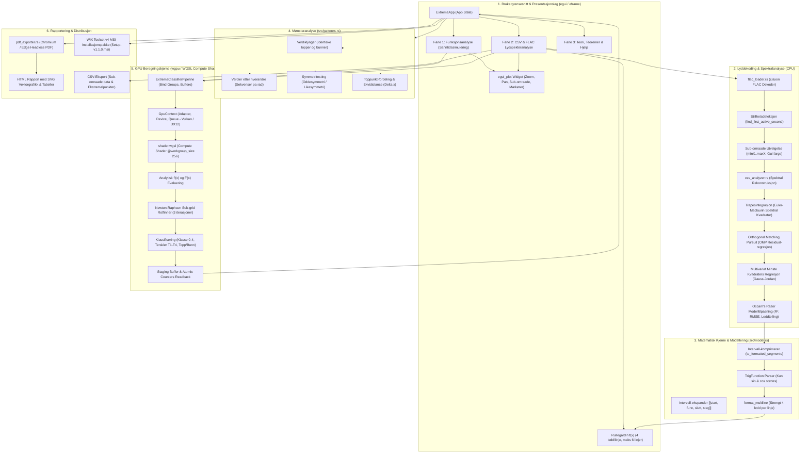
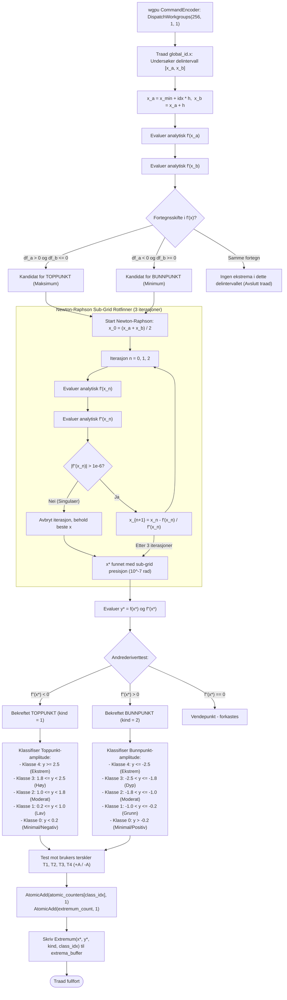
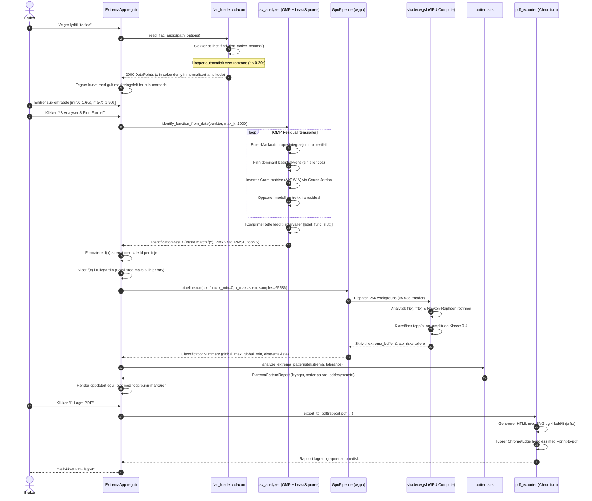
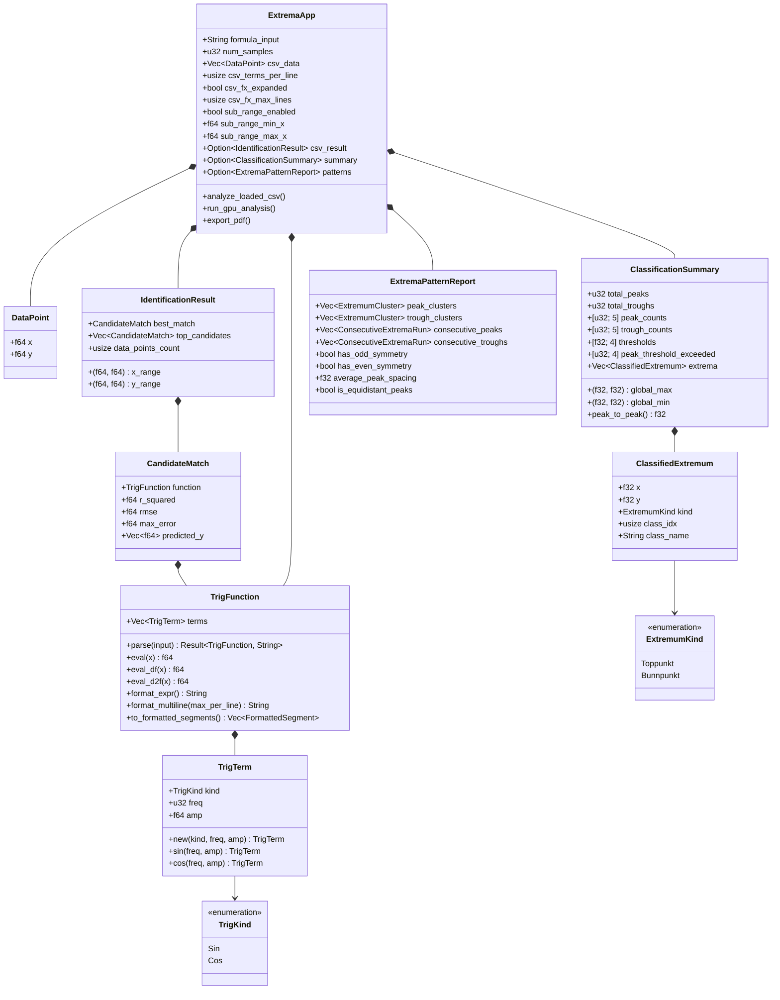
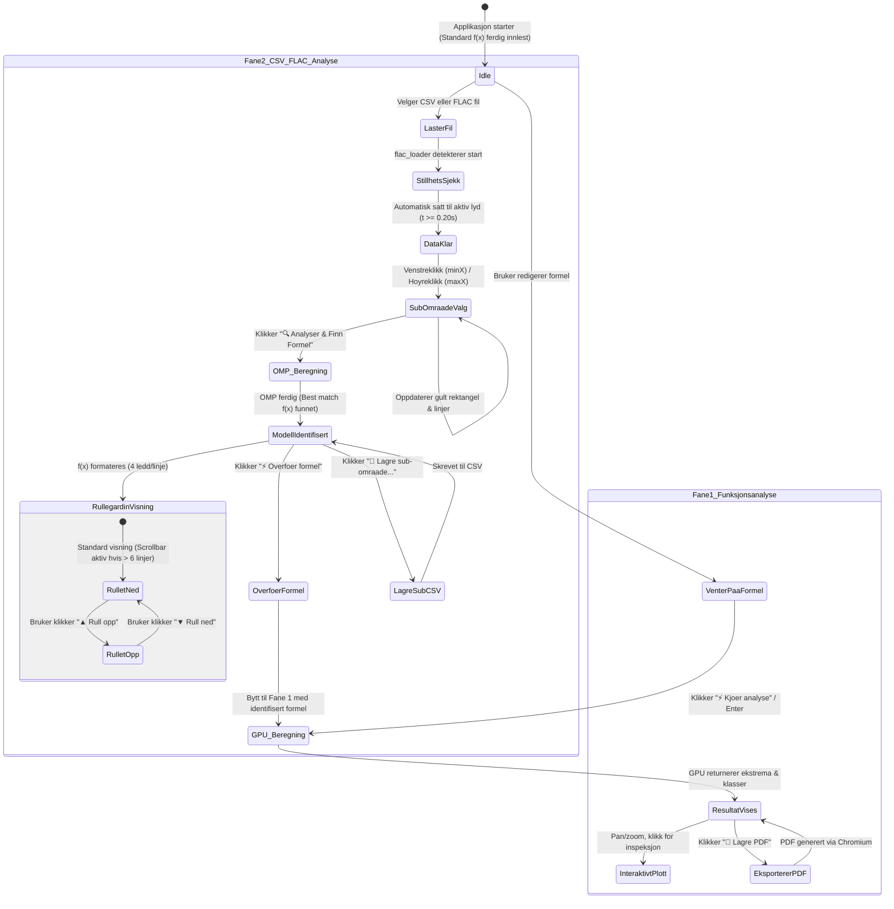

# Teknisk Arkitektur & Systemdiagrammer

Dette dokumentet presenterer den formelle arkitekturen, modulære oppbygningen, databehandlingspipelinen og maskinvareinteraksjonen i **Trigonometrisk Ekstremanalyse & Rekonstruksjon (GPU Sanntid)**.

---

## 1. Overordnet Systemarkitektur

Systemet er bygget i **Rust** og inndelt i seks kjernekomponenter: brukergrensesnitt (`eframe`/`egui`), spektralanalyse og lyddekoding (`claxon`), matematisk funksjonsmodell og parser, mønstergjenkjenning, en massivt parallell GPU-beregningskjerne via **WebGPU (`wgpu`) med Vulkan / DirectX 12**, samt rapportering og WiX-distribusjon.

---

## 2. End-to-End Databehandlings- og Rekonstruksjonspipeline

Denne flyten viser hvordan en rå FLAC-lydfil (som [`te.flac`](file:///c:/Users/rober/OneDrive/Bilder/te.flac)) eller CSV-måleserie transformeres til en ferdig matematisk formel, klassifiseres på GPU og visualiseres.

```mermaid
flowchart TD
    Start(["Bruker velger fil: CSV eller FLAC"]) --> InputCheck{"Filtype?"}

    %% FLAC gren
    InputCheck -- ".flac" --> Decode["claxon: Dekoder 16-bit PCM mono/stereo"]
    Decode --> Silence["find_first_active_second: Detekterer og skipper romstoy (t < 0.20s)"]
    Silence --> Downsample["Ekvidistant nedsampling til N maelepunkter (Hz-skala)"]

    %% CSV gren
    InputCheck -- ".csv" --> ParseCSV["csv_analyzer: Leser kolonner x, y (Robust float-parsing)"]

    %% Felles forbehandling
    Downsample --> PreMerge["DataPoint-vektor klargjort"]
    ParseCSV --> PreMerge

    PreMerge --> SubSelect{"Sub-omraade aktivert?"}
    SubSelect -- "Ja" --> Slicing["Filtrerer punkter: x in [minX, maxX] (Gul farge i GUI)"]
    SubSelect -- "Nei" --> FullData["Bruker hele datasettet"]

    Slicing --> NyquistCalc["Beregner fysikalsk Nyquist-frekvens w_nyq = pi / delta_x"]
    FullData --> NyquistCalc

    %% Spektralanalyse
    NyquistCalc --> OMPLoop["1. Orthogonal Matching Pursuit (OMP Iterasjon)"]
    OMPLoop --> Trapezoid["2. Trapesintegrasjon (Euler-Maclaurin kvadratur mot residual)"]
    Trapezoid --> BestFreq["3. Velg basisfunksjon med maks korrelasjon: sin(kx) eller cos(kx)"]
    BestFreq --> GramMatrix["4. Multivariat regresjon over valgte baser (A^T W A) c = A^T W y"]
    GramMatrix --> GaussJordan["5. Gauss-Jordan eliminasjon med Tikhonov-regularisering"]
    GaussJordan --> UpdateResidual["6. Oppdater residual: r_{s+1}(x) = y(x) - y_hat(x)"]
    UpdateResidual --> OMPTermCheck{"Ferdig? (R² > 0.9999 eller residual konvergert)"}
    OMPTermCheck -- "Nei" --> OMPLoop
    OMPTermCheck -- "Ja" --> OccamFilter["Occam's Razor: Velg enkleste modell blant topp-kandidater"]

    %% Formatering
    OccamFilter --> Compress["Intervall-komprimering: 3+ paafolgende harmoniske -> [[start, func, slutt]]"]
    Compress --> MultilineFormat["Formatering: Maks 4 ledd per linje (format_multiline)"]
    MultilineFormat --> UIRullegardin["GUI Visning: Rullegardin begrenset til maks 6 linjer (med scroll & rull opp/ned)"]

    %% GPU evaluering
    UIRullegardin --> GpuSubmit["Klargjor GPU uniform buffer (Params + 64 terms)"]
    GpuSubmit --> DispatchGPU["Kjor wgpu Compute Pipeline (65 536 traader)"]
    DispatchGPU --> ReadbackGPU["Readback: Ekstremalpunkter, amplitude-klasser, terskeltelling"]
    ReadbackGPU --> RunPattern["Mønsteranalyse: Like verdier, klynger, sekvenser, symmetri"]
    RunPattern --> RenderAll["Oppdater egui_plot, zoom-utsnitt og resultatpaneler"]
    RenderAll --> ExportOption{"Bruker velger eksport?"}
    ExportOption -- "PDF Rapport" --> ChromiumPDF["Chromium/Edge Headless PDF eksport (A4 med SVG og 4 ledd/linje)"]
    ExportOption -- "CSV Data" --> SubCSV["Eksporter filtrert sub-omraade til ny CSV"]
    ExportOption -- "Ingen" --> Done(["Interaktiv utforsking fullfort"])
```

---

## 3. GPU Compute Shader & Newton-Raphson Pipeline

Detaljert arbeidsflyt for hver enkelt GPU-tråd inne i [`src/gpu/shader.wgsl`](file:///c:/dev/gpu_extrema_classifier/src/gpu/shader.wgsl) over intervallet $[x_{\min}, x_{\max}]$ fordelt på 65 536 tråder med arbeidsgruppestørrelse 256 (`@workgroup_size(256)`).

---

## 4. Sekvensdiagram: Komplett Analyseforløp

Dette sekvensdiagrammet illustrerer tidslinjen og ansvarsfordelingen mellom brukeren, brukergrensesnittet, lyd/CSV-motoren, OMP-rekonstruksjonen, GPU-kjernen og PDF-generatoren.

---

## 5. Datamodell & Klasserelasjoner

Klassediagrammet viser sammenhengen mellom datastrukturene i Rust-kjernen:

---

## 6. Tilstandsmaskin for GUI (User Interaction State Machine)

Diagrammet illustrerer tilstandene og overgangene i applikasjonens levetid under analyse av signaler og ekstrema:

---

## 7. Oppsummering av Nøkkelprinsipper

| Egenskap | Teknisk Realisering | Teoretisk Begrunnelse |
| :--- | :--- | :--- |
| **Matematiske funksjoner** | Kun `sin` og `cos` støttes | Hilbert-rom ortogonalitet og unngår poler/asymptoter (`tan`, `cot`). |
| **GPU Sub-grid presisjon** | Analytisk Newton-Raphson på GPU | Kvadratisk konvergens $\mathcal{O}(e^2)$ gir $10^{-7}$ rad nøyaktighet på 3 iterasjoner. |
| **Trapesintegrasjon** | Euler-Maclaurin korrigerte vekter | Fjerner endepunktsdobling $x=0$ og $x=2\pi$; gir spektral konvergens for glatte funksjoner. |
| **Krysstale-eliminering** | Orthogonal Matching Pursuit (OMP) | Fjerner lekkasje fra dominerende ledd på ikke-periodiske vinduer via trinnvis residual. |
| **Lyddeteksjon** | `find_first_active_second` | Hopper over innledende romtone i taleopptak ([`te.flac`](file:///c:/Users/rober/OneDrive/Bilder/te.flac)) automatisk. |
| **Sub-område visualisering** | Gult rektangel & grenselinjer | Tydelig fargekodet avgrensning av analyseutsnittet med ett-klikks zoom. |
| **Formelvisning** | 4 ledd per linje & 6-linjers rullegardin | Kompakt og ryddig monospace-presentasjon som aldri fortrenger grafen. |
| **Rapportering** | Chromium/Edge Headless PDF | Vektorgrafikk (SVG) og identisk formattering som i programvaren. |
